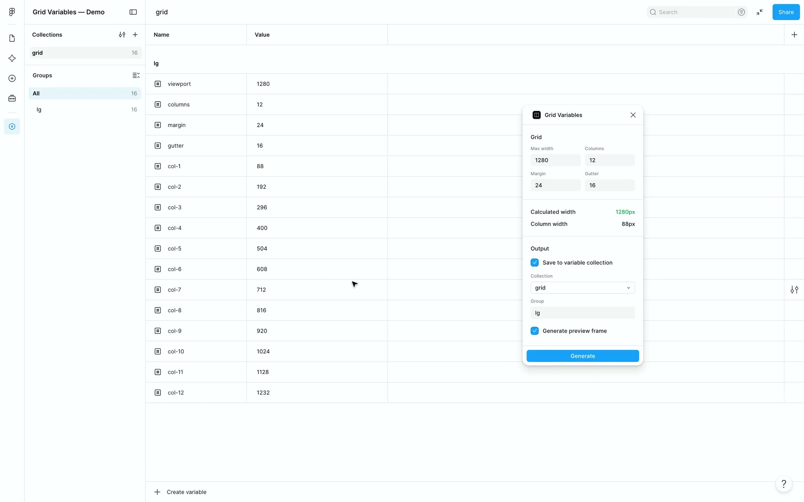
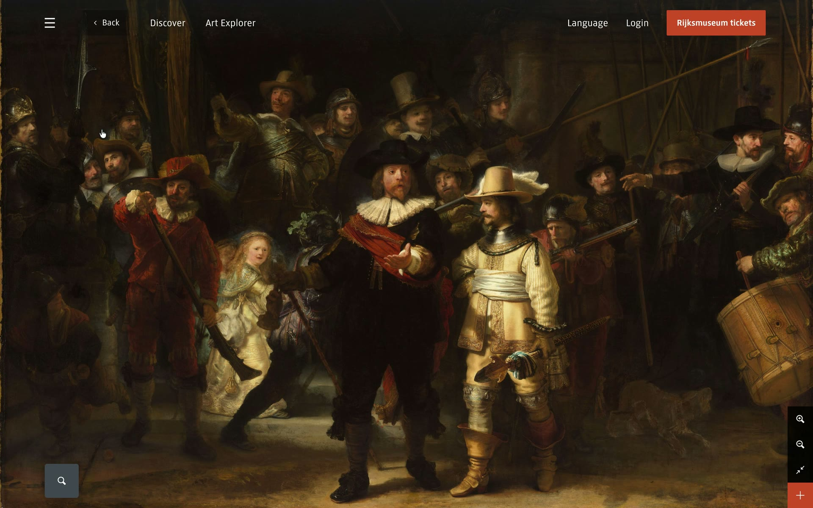

# recital

Script narrated demo videos of anything in a browser. A scenario says what to
click and what to say; the recorder drives Chromium with a calm cursor and records at
60 fps, paced to the voice: 3200×1800 by default, or any size and pixel ratio
(`viewport`, `scale`). When the product changes, record it again.

Or ask an AI agent to make one: see [With an agent](#with-an-agent).

| [](docs/media/grid-variables.mp4) | [](docs/media/website.mp4) |
|---|---|
| A Figma plugin, narrated: [Grid Variables](docs/media/grid-variables.mp4) | A website: [Rijksmuseum](docs/media/website.mp4) ([scenario](examples/scenarios/rijksmuseum.js); artworks in the public domain) |

## Install

Node 20 or later and ffmpeg. Demos live in a workspace of their own:

```sh
mkdir my-demos && cd my-demos && npm init -y
npm i -D recitaljs
npx playwright install chromium
brew install ffmpeg          # or apt install ffmpeg
npx recital init            # scenarios/example.js and a .gitignore
npx recital doctor          # checks ffmpeg, Chromium, the voice and keys
npx recital demo example    # records output/example/take.mp4
```

## A scenario

`scenarios/signup.js`:

```js
// @ts-check
/** @type {import("recitaljs").Scenario} */
export default {
  url: "http://localhost:3000",
  steps: [
    { click: { ui: "role=link[name='Sign up']" }, label: "open" },
    { type: "Ada Lovelace", into: { ui: "[name=name]" }, label: "name" },
    { click: { ui: "role=button[name='Create account']" }, waitFor: { ui: "text=Welcome" }, label: "create" },
  ],
  narrator: { voice: "bf_emma" },
  narration: [
    { at: "open", text: "Start by opening the sign-up page." },
    { at: "create", text: "Finally, click Create account, and you're in." },
  ],
  camera: [
    { at: "name", center: [800, 400], zoom: 1.5 },   // in on the form, viewport px
    { at: "create", zoom: 1, ms: 1200 },             // back out over 1.2 s
  ],
};
```

```sh
npx recital demo signup     # the take, paced to the lines
npx recital narrate signup  # the final video: output/final/signup.mp4
npx recital camera signup   # a version that zooms, from camera
```

The two comment lines give editor autocomplete and typo checks: every key, action, target and
option is described in [types.d.ts](types.d.ts). A step is `{ <action>: <target or value>, ...options }`;
the actions are `move`, `click`, `drag`, `check`, `type`, `paste`, `press`, `chooseFiles`,
`scroll`, `wheel`, `tab`, `waitFor`, `hold`, `cursor` and `eval`. Targets are a Playwright
selector (`{ ui }`) or a point (`{ point: [x, y] }`); apps that need more, like a canvas or a
plugin's window, get an adapter: Figma's is built in ([docs/figma.md](docs/figma.md)), and you
can write your own ([docs/adapters.md](docs/adapters.md)).

## Narration

Each line starts at a step, and the take waits for it. Voices are **Kokoro**, local and free
(`narrator: { voice: "af_heart" }`), or **ElevenLabs** (`{ provider: "elevenlabs", voice: "Lily" }`
with `ELEVENLABS_API_KEY` in `.env`). `narrate` makes `output/final/<demo>.mp4` with burned-in
captions, plus a `-plain.mp4` with `.vtt` and `.srt`. [docs/narration.md](docs/narration.md)
is on writing the lines.

## With an agent

Ask for a demo, such as "Record a narrated demo of signing up on localhost:3000.", and the
agent plans it, writes the scenario, records it, looks at the frames, fixes what's off, and
writes the narration. The scenario stays, so when the product changes, ask it to record again.

**Any MCP client** (Codex, Cursor, VS Code, Claude Code, Gemini CLI…): `recital mcp` is an MCP
server on a folder of demos.

```json
{ "mcpServers": { "recital": { "command": "npx", "args": ["-y", "-p", "recitaljs", "recital", "mcp", "-w", "~/demos"] } } }
```

Or `claude mcp add recital -- npx -y -p recitaljs recital mcp -w ~/demos` (`codex mcp add`
takes the same).

**Claude Desktop, with no terminal**: download
[`recital-darwin-arm64.mcpb`](https://github.com/mariusroosendaal/recital/releases/latest/download/recital-darwin-arm64.mcpb),
open it, and pick a folder for the demos. **ChatGPT and Codex**: a plugin from this
repository. Both: [docs/desktop.md](docs/desktop.md).

**An agent skill**, the same workflow through the CLI: `npx recital skill` copies
`skills/demo/SKILL.md` into `.claude/skills/`, or in Claude Code
`/plugin marketplace add mariusroosendaal/recital` and `/plugin install recital@recital`.

## Commands

| Command | Does |
|---|---|
| `demo <demo>` | Records `output/<demo>/take.mp4`, with `take.steps.json` and a 1600 px `take-phone.mp4`. `--dry` runs without recording, `--headless` without a window (the default on Linux with no display), `--keep-open`, `--scale`, `--cursors <set>`, `--inspect <probe>` runs a script on the page after setup. |
| `demo login <url \| demo \| adapter>` | Opens the browser to log in once, at a URL, a scenario's page or an adapter's login (`figma`); the profile is kept. |
| `validate [<demo> ...]` | Checks scenarios without a browser. |
| `camera <demo>` | A version that zooms in, from the scenario's `camera`: 1.2× the viewport, 1920×1080 by default. |
| `narrate <demo>` | Mixes in the narration, with subtitles. `--voice A,B --variant steady,warm` compares voices on one take. |
| `clips <demo>` | A clip per part (labels sharing a word before ` · `). `--gif`, `--crop`, `--speed`, `--width`. |
| `frames <demo>` | PNG frames and a contact sheet: `--every 1`, `--at 1.5,3.2`, `--steps`. |
| `scripts` | `NARRATION.md`: every scenario's lines, for review. |
| `doctor`, `init`, `skill`, `mcp` | As above. |

Any command takes `-w <path>`. Everything goes in `output/<demo>/`; the browser profile and the
Kokoro model are shared, in `~/Library/Caches/recital` (`~/.cache` on Linux; `RECITAL_CACHE`).

## In CI

On Linux with no display, takes record headless, so CI can record the demos again after each
deployment and fail when a step stops working: see [docs/ci.md](docs/ci.md).

## Developing

Clone, `npm install`, and add it to a workspace with `npm install --save-dev file:../recital`.
`npm test` runs the checks, `npm run test:smoke` records the self-test in `examples/`.
`scripts/mcpb.sh` and `scripts/plugin.sh` pack the Claude Desktop extension and the
ChatGPT/Codex plugin.

MIT license.
